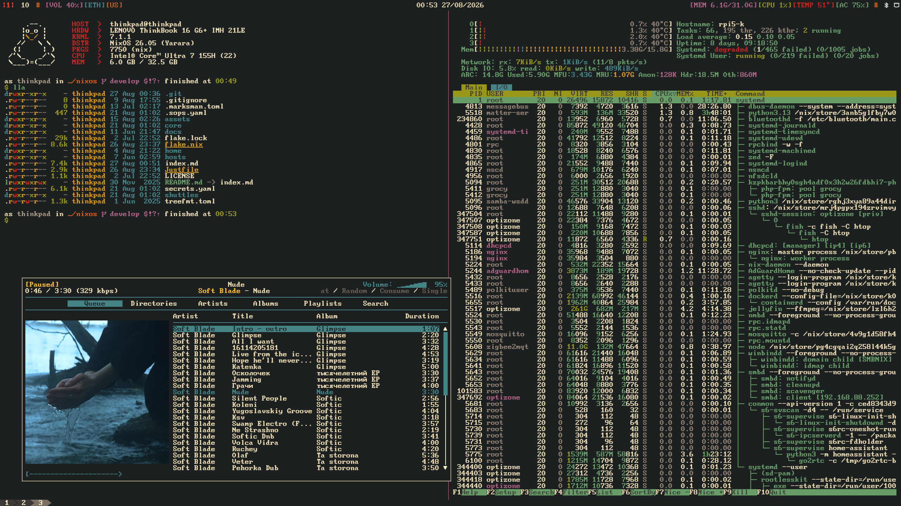
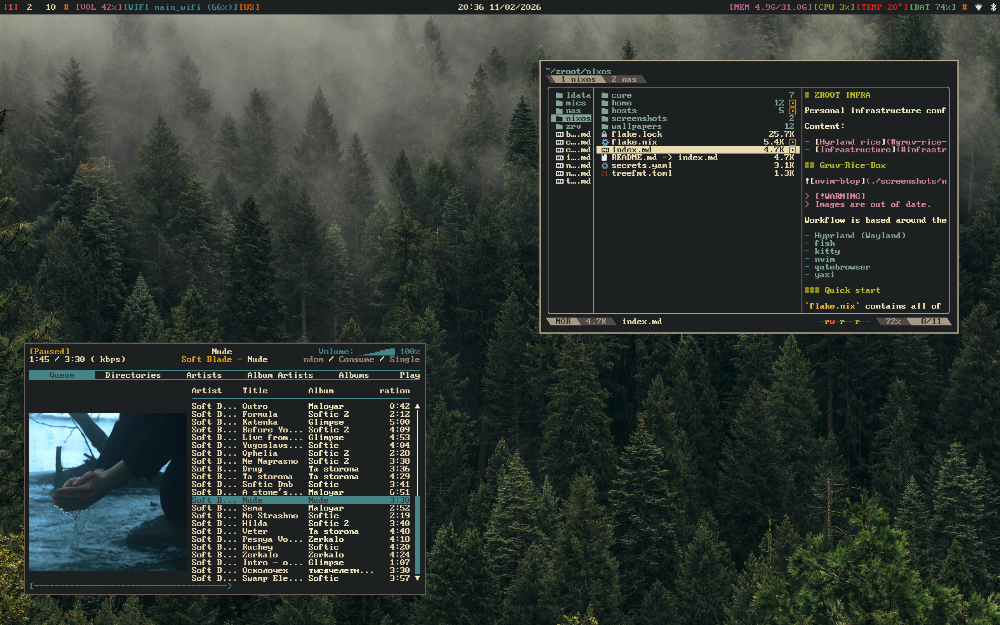
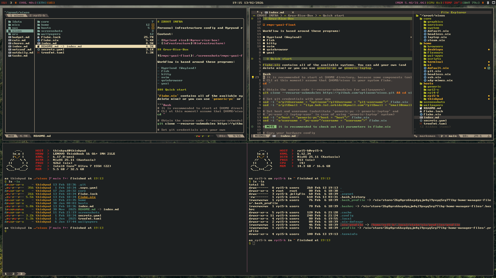
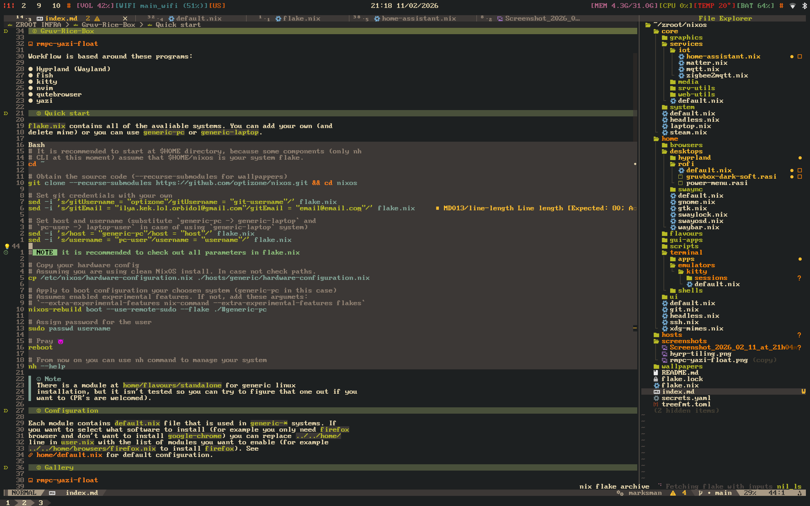

# zroot/nixos

<!--toc:start-->

- [zroot/nixos](#zrootnixos)
  - [Gruv-Rice-Box](#gruv-rice-box)
    - [Quick start](#quick-start)
    - [Services](#services)
    - [Gallery](#gallery)
  - [Infrastructure](#infrastructure)
    - [Quick start](#quick-start-1)
    - [Devices](#devices)
  - [Special thanks](#special-thanks)

<!--toc:end-->

Personal infrastructure config and Hyrpand rice.

Idea is to have one directory (`/zroot`) to be a _consentually_ self replicating
Zettelkästen, infrastructure code and data.

```bash
zroot
├── ldata
│   ├── backups
│   ├── builds
│   ├── code
│   ├── disk-images
│   ├── persist # for impermanence
│   ├── media # jellyfin and immich expect these dirs to exist
│   │   ├── movies
│   │   ├── music
│   │   ├── gallery
│   │   └── tv
│   ├── secrets
│   └── wiki # kiwix-images zeal maps and other knowledge sources
├── nas
│   ├── rpi4-f # each is a mounted `/zroot` (dir = NAS hostname)
│   └── rpi5-k
├── nixos # this repo
├── notes # your second brain
└── shuttles # mounted drives
    └── apollo11 # can be used as live-iso
        ├── zroot
        ├── boot
        └── nix
```

That leaves only two (`/boot` and `/nix`) to worry about. With
[impermanence](https://github.com/nix-community/impermanence) we can persist
only these three directories.

Using `rsync` we can set rules of what data should be backed up where. For
instance:

```bash
rsync /zroot/notes/              /zroot/nas/rpi4-f/notes
rsync /zroot/ldata/media/movies/ /zroot/nas/rpi5-k/ldata/media/movies
rsync /zroot                     /zroot/shuttles/k1/zroot
```

Assuming `rsync` runs every day, you can be sure, that `/zroot` is up to date on
all machines you have. This way it is trivial to add, replace or recover
servers.

## Gruv-Rice-Box

Gruvbox colored retro config. No animations, no opacity, no applets, only
terminal (and an occasional gui).



Workflow is based around these programs:

- hyprland
- kitty
- nvim
- qutebrowser
- yazi

### Quick start

> [!WARNING]
> Read and understand the scripts you are runing.

`flake.nix` contains all of the avaliable systems. You can add your own (and
delete mine) or you can use `generic-pc` or `generic-laptop`.

```bash
# It is recommended to start at $HOME directory, because some components (only nh
# CLI at this moment) assume that $HOME/nixos is your system flake.
cd ~

# Obtain the source code (--recurse-submodules for wallpappers)
git clone --recurse-submodules https://github.com/optizone/nixos.git && cd nixos

# Run install script
just install
```

dmenu: `WIN+SHIFT+D`;\
kitty: `WIN+ENTER` (`ALT+T`: new tab; `ALT+ENTER`: new window);\
yazi: `WIN+SHIFT+ENTER`;\
browser: `WIN+SHIFT+O`;\
quit: `WIN+Q`;\
keybinds: `WIN+F1`;

### Services

In this repo you can find configs for some bundles of services connected in one
homelab that can span multiple servers (including user laptops and PCs).

Monitoring:

- `smartd + node_exporter -> prometheus -> grafana`
- `wakatime-cli -> wakapi`
- `sysbench + stress-ng`
- `htop + iotop + iperf` and a bunch of other system monitoring tools
- `wireshark`

NAS/Media: `samba + jellyfin + immich`

IoT: `home-assistant + zigbee2mqtt + matter-server + mosquitto`

Virtualization: `incus + podman`

Personal finance: `actual`

Car service bookkeeping: `lubelogger`

AI: `ollama + pi`

Meshtastic: `mnodes + contact` (configs and TUI)

Misc: `paperless-ng`

ERP: `grocy`

Distributed build: each server is a part of distributed nix build network.

GUI/CLI/TUI programs can be found in [modules/apps/](./modules/apps).

### Gallery







## Infrastructure

> [!WARNING]
> This section (as also this very git repo) is under heavy development. Use
> wisely, don't run commands that you don't understand or haven't read.

All servers are using impermanence (`/` gets wiped at every boot) and sops to
manage secrets. This combo creates some challenges in provisioning systems on
new servers and also in configuring new services, so be causious on what you
really need to persist and don't forget to do so (usually, persist config is
bundled with the module itself).

### Quick start

```bash
just provision "<host>" "[<host-ip>]"
```

This will run `nixos-anywhere`, which can load kexec image to provision new
system. For RaspberryPi you may need to run installer image, because kexec is
not supported there.

### Devices

| name     | hardware                  | comment                             |
| -------- | ------------------------- | ----------------------------------- |
| thinkpad | ThinkBook 16 G6+ IMH 21LE | workstation                         |
| rpi5-k   | RaspberryPi 5 16GB        | main server: nas, media, etc        |
| rpi4-f   | RaspberryPi 4 8GB         | test server                         |
| oldboi   | Custom PC 8GB             | local ai + nas + test playground    |
| ntt      | Custom PC 32GB            | immich + nas                        |
| vm0      | ---                       | vm for tests                        |
| opi2-c   | OrangePi Zero 2 W 4GB     | minivan brains and mesh radio (WIP) |

## Special thanks

To @Frost-Phoenix for my first configs.\
To @grahamc for his post
["Erase your darlings"](https://grahamc.com/blog/erase-your-darlings/).\
To nix community for making this possible.
